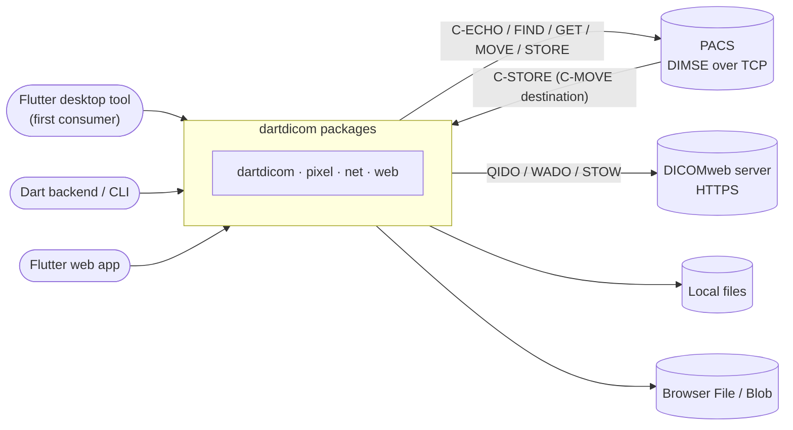
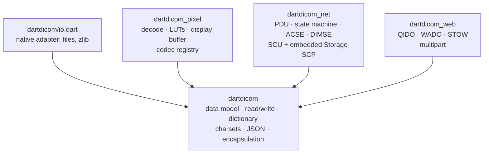
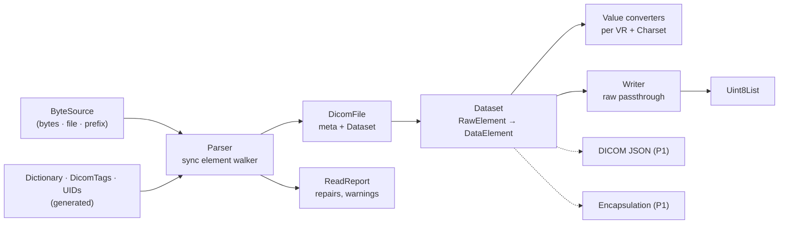
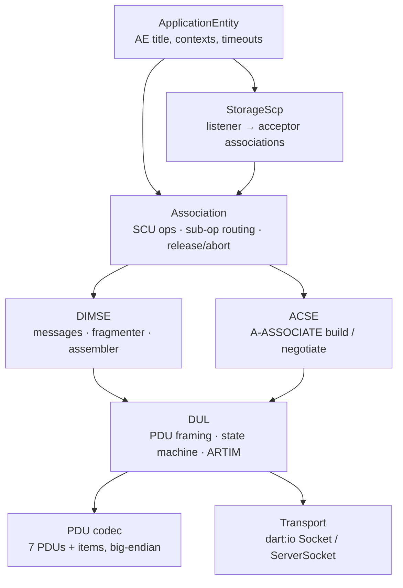
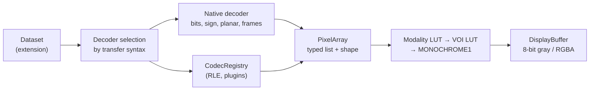
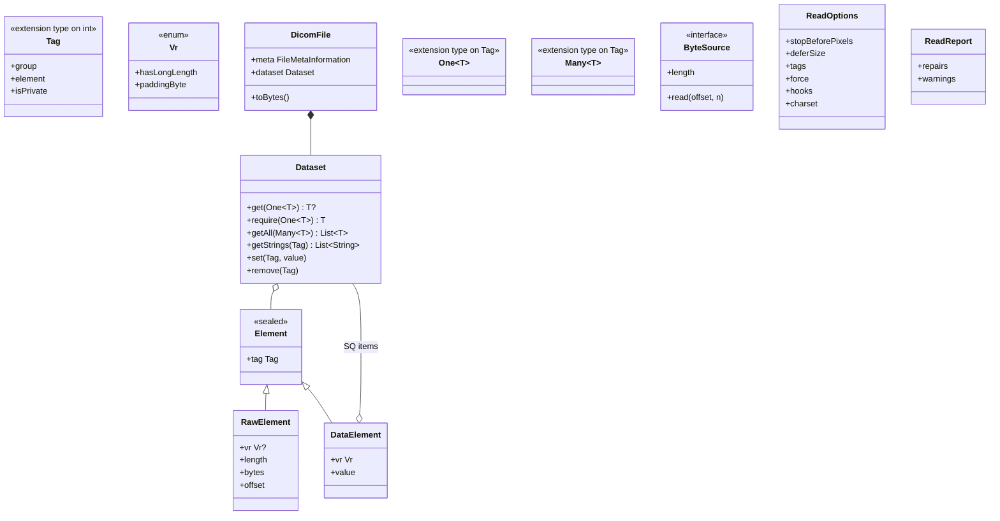
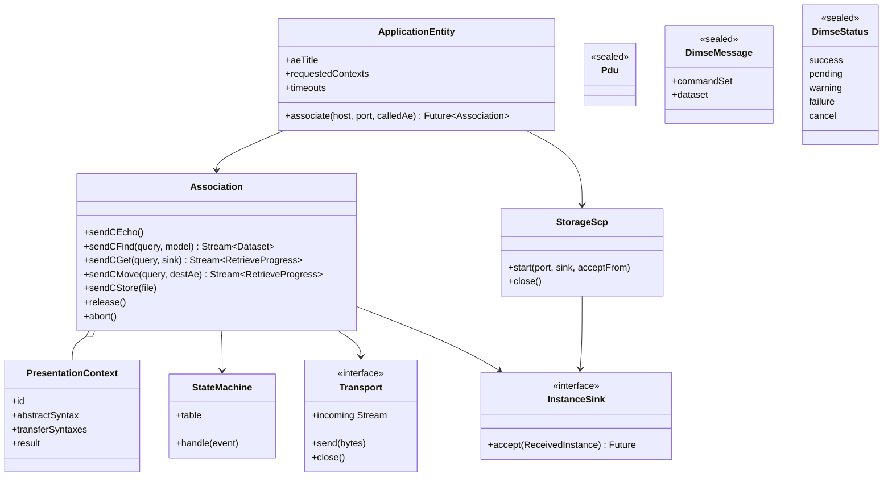
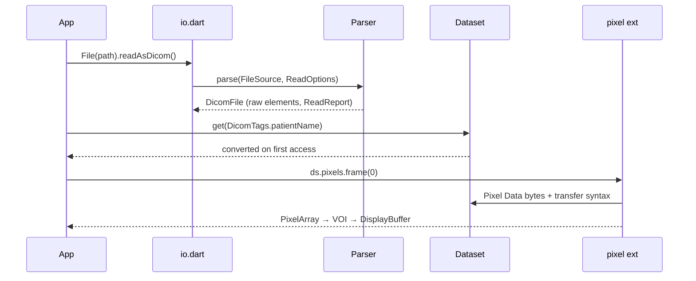
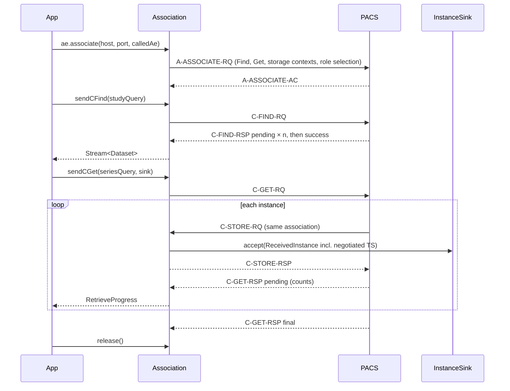
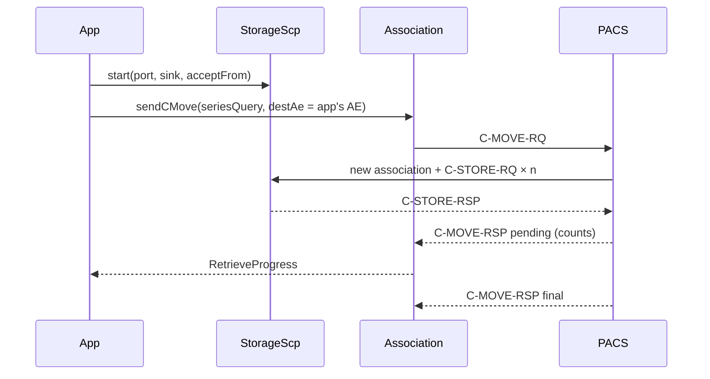

# dartdicom: system and OOP architecture

> Source: [requirements](../req/dartdicom-prd.md) and the 2026-10-16 design review · Date: 2026-10-16 · Mode: Design · Type: Library
> See also: [Data architecture](02-data-architecture.md) · [Developer and agent surface](03-surface-architecture.md) · [Codebase blueprint](../structure/01-codebase-blueprint.md) · [Progress](../progress/overview-v0.md)

Status: first-pass draft, to be refined. Decisions D1–D4 were made on 2026-10-16 (§9).

## 1. Overview

dartdicom is a set of four pure-Dart packages:

- **`dartdicom`** reads, modifies and writes DICOM data.
- **`dartdicom_pixel`** turns Pixel Data into numbers you can display.
- **`dartdicom_net`** speaks DIMSE to a PACS.
- **`dartdicom_web`** speaks DICOMweb.

The first consumer is a Flutter desktop tool. It queries a PACS, retrieves studies and displays them, with no sidecar runtime ([PRD](../req/dartdicom-prd.md), G1).

**Type: Library.** Each package publishes a public API on pub.dev that apps import. No package has an entry point of its own. Runnable code exists only in `example/` folders and the interop tooling.

**Stack.**

| Where | What |
|---|---|
| Toolchain | Dart ≥ 3.6 (pub workspace) |
| Core | `dart:typed_data`, `dart:convert` |
| Native adapter and `dartdicom_net` | `dart:io` |
| `dartdicom_web` | `package:http` |
| Dev dependencies | `package:test`, `package:lints` |
| Fixture tooling | Python with uv, pydicom, pynetdicom |
| Interop tooling | Orthanc and DCMTK in Docker |

**Lineage.**
- The *internals* come from pydicom and pynetdicom, which are proven: lazy raw elements, raw passthrough on write, the plugin chain, and the PS3.8 state table expressed as data.
- The *public API* follows fo-dicom, which solved the same problem in a statically typed language: generated tag constants, typed getters, a file that *contains* its meta, and per-instance configuration.

| Concept | pydicom / pynetdicom | fo-dicom | dartdicom |
|---|---|---|---|
| Tag | `BaseTag(int)`, keyword strings | `DicomTag.PatientName` | `extension type Tag(int)`, plus generated typed tags: `DicomTags.patientName` is a `One<String>` |
| Element | `RawDataElement` → `DataElement` | `DicomElement` subclass per VR | `sealed Element`, either `RawElement` or `DataElement` |
| File | `FileDataset` *is a* `Dataset` | `DicomFile` *has a* meta and a dataset | `DicomFile` *has a* meta and a dataset |
| Read | `dcmread`, generator | `DicomFile.Open` | `DicomFile.fromBytes` / `File(path).readAsDicom()`, a synchronous parser |
| Config | module globals | DI plus option objects | option objects per call or instance, no globals |
| Pixel | `ds.pixel_array` | `DicomPixelData`, `IDicomCodec` | an extension on `Dataset`, plus a `CodecRegistry` |
| Network | 2 threads per association, joined by queues | async client and server | one event loop, with each association as an async task |
| SCP events | `evt.EVT_*` handlers | subclass `DicomService` | typed handler callbacks |
| C-FIND results | generator | callback | `Stream` |

## 2. System context



The packages are libraries running inside the caller's process. They own no state, store, or service of their own. Two arrows matter here:

- **The PACS → dartdicom arrow.** For C-MOVE the PACS opens a *new* association back to the app. That makes the embedded Storage SCP a P0 requirement (N-09).
- **Browsers.** They can reach DICOMweb but never DIMSE, because they have no raw TCP.

## 3. High-level structure (packages)



| Package | Responsibility | Platforms | Depends on | Priority |
|---|---|---|---|---|
| `dartdicom` | Turns bytes into a `DicomFile`/`Dataset` and back. Owns tags, the dictionary, UIDs, VRs and charsets. | all | none in the ecosystem | P0 |
| `dartdicom/io.dart` | Reads and writes by path, provides a random-access file source and a zlib-backed deflate codec | native only | `dart:io` | P0 |
| `dartdicom_pixel` | Turns Pixel Data into a `PixelArray`, applies the Modality and VOI LUTs, and produces an 8-bit display buffer | all (native codecs: native only) | `dartdicom` | P0 |
| `dartdicom_net` | Acts as an Application Entity: SCU operations, plus the embedded Storage SCP | native only | `dartdicom`, `dart:io` | P0 |
| `dartdicom_web` | DICOMweb client | all (browser: needs CORS) | `dartdicom`, `package:http` | P1 |

**Dependency rules.** These come from the PRD constraints; the blueprint says what enforces each one.

1. `dartdicom` depends on no ecosystem package. Its `lib/dartdicom.dart` imports no `dart:io`, `dart:ffi` or Flutter.
2. The other three depend on `dartdicom` only, never on each other.
3. No package depends on Flutter.
4. `dart:io` appears only in `dartdicom/io.dart` and `dartdicom_net`. Any other platform-specific code sits behind a conditional import: `if (dart.library.io)` / `if (dart.library.js_interop)`.

**Repository strategy.** This decision used to be ADR-001; it now lives here.

- **One monorepo for the pure-Dart family.** `github.com/Lightbridge-KS/dartdicom` holds the four packages as a single pub workspace.
- **Separate repos for anything with a different toolchain, license or release cadence.** That covers native and WASM codec packages and a future `dartdicom_flutter`. These live as separate repos under the same owner, and they depend only on *published* versions.

Reasons:
- Changes that span packages land together while the core API is still settling.
- There is one place for lints, fixtures, golden tooling and interop CI.
- An AI assistant sees the whole system in one checkout.
- Native build files and third-party license notices stay out of the pure-Dart repo. fo-dicom keeps its codecs in a separate repo for the same reason.

A package moves out of the monorepo when any of these holds: it is ≥ 1.0 and rarely changes together with the core; it needs its own maintainer, toolchain or license; or its CI slows down the pure-Dart loop.

## 4. Components

### 4.1 `dartdicom` (core)



- **Parser.** A synchronous walk over a `ByteSource`. It reads the preamble, then group 0002, picks the transfer syntax, then walks the elements, inflating deflated data on the way.
  - It *slices* values without decoding them. It stops early when a stop condition is met (e.g. before Pixel Data, or after the tags requested), and it defers values above a size threshold.
  - Repairs made by lenient reading (C-10) go into the `ReadReport`. They are never applied silently.
- **Dataset.** Kept in tag order. An element arrives as a `RawElement` and becomes a `DataElement` on first typed access. The conversion uses the dataset's charset and the caller's hooks, and its result is cached.
- **Writer.** The mirror image of the parser. An element nobody touched, written in the same encoding, is copied byte for byte. Everything else is re-encoded by the per-VR writers.
- **Dictionary, `DicomTags` and UIDs.** Generated by `dartdicom/tool/gen_dictionary` from a pinned DICOM release, using PS3.6 for data elements and PS3.7 for command elements.

### 4.2 `dartdicom_net`



- **One event loop, no threads.**
  - Each association is an async task that owns one socket.
  - Turning TCP chunks into whole PDUs is a stream transformer.
  - The state machine is the PS3.8 transition table expressed as data: (event, state) → (action, next state). It can be tested without sockets.
- **C-GET receive loop.** C-GET's C-STORE sub-operations arrive on the same association. The receive loop simply handles them; pynetdicom needs a separate reactor thread to do the same.
- **StorageScp.** It reuses the acceptor half of `Association`, so the acceptor path is P0 even though the general SCP framework (N-15) is P1. It accepts Verification and the storage SOP classes. For each context it prefers an uncompressed syntax and falls back to any compressed one the core knows: instances are stored as received, so even a compressed one is kept, though `dartdicom_pixel` can't yet display it *(M3 decision 4)*.
- **Datasets** are decoded by `dartdicom` straight from the reassembled PDV bytes. Received instances go to a caller-supplied `InstanceSink` one at a time (N-11). Each one arrives as a `ReceivedInstance` carrying the transfer syntax negotiated for its presentation context, because the dataset bytes themselves don't say how they are encoded. *(amended: [blueprint F10](../structure/01-codebase-blueprint.md#1-reconciliation-findings))*

### 4.3 `dartdicom_pixel`



Uncompressed data becomes a zero-copy typed-data view wherever byte order and alignment allow. Encapsulated data goes through core's frame iteration (C-18) and then a codec. The first consumer asks the PACS for uncompressed transfer syntaxes only (N-03), so codecs aren't needed for P0.

### 4.4 `dartdicom_web` (P1)

`DicomWebClient` builds QIDO, WADO and STOW requests on top of an injected `http.Client`. Responses are parsed by a streaming `multipart/related` parser, and core decodes each part as DICOM JSON or Part 10. Search always returns `Dataset`s (W-02). In browsers, responses stream but STOW request bodies are held in memory (W-05).

## 5. OOP and class architecture

This is a sketch. The object model the implementer works from is in the [blueprint](../structure/01-codebase-blueprint.md).

### 5.1 Core



- **Patterns.**
  - *Ports and adapters*: `ByteSource` and `DeflateCodec` are defined in core, with adapters in `io.dart`, the web glue and tests.
  - *Lazy conversion*: a `RawElement` is replaced by a `DataElement` on first access.
  - *Code generation*: `DicomTags`, the dictionary and the UID constants.
  - *Strategy*: per-VR value converters chosen from a table.
- **SV and UV values are `BigInt` on every platform.** UV goes up to 2⁶⁴−1, which doesn't fit a signed 64-bit `int` even on the VM, and dart2js integers are exact only to 2⁵³. OV values stay as bytes.
- **Element model (D2, decided 2026-10-16).** One `DataElement` with a `Vr` and a decoded value. The `Vr` enum and the converter table carry the behavior that varies by VR.
  - **Typed reads go through typed tags** *(amended by [data architecture DA1](02-data-architecture.md#34-the-vr--dart-type-contract))*. A generated constant is `One<T>` or `Many<T>`, following the dictionary's VM, so the read is `ds.get` / `ds.require` / `ds.getAll` and the compiler rejects a wrong one.
  - Untyped tags (private tags, keyword lookups) use list-only getters per value family.
  - Rejected: sealed subclasses per value family (about 6), and fo-dicom's subclass per VR (about 30).
  - Revisit if the writer or the validator needs polymorphism by VR.

### 5.2 Net



- **Patterns.**
  - *Table-driven state machine*: the PS3.8 transitions as data.
  - *Stream transformer*: PDU framing.
  - *Sealed hierarchies* with exhaustive `switch`, for PDUs, DIMSE messages and statuses.
- **Failure model (D3, decided 2026-10-16).** Rejected alternatives: throwing on every non-success status, and result types everywhere. The model:
  - transport, association (reject, abort), protocol-violation and timeout failures **throw** typed exceptions
  - DIMSE responses come back as a sealed **`DimseStatus` value**, because *pending* and *warning* are normal outcomes
  - `.orThrow()` turns a failure status into an exception
  - **multi-response operations** (C-FIND, C-GET, C-MOVE) complete their stream normally on a final Success, Warning or Cancel. A final **Failure** becomes a stream error (`DimseFailureException`), so a failed query never looks like "no matches". Retrieves also carry the final status in their last `RetrieveProgress`. *(amended: [surface S5](03-surface-architecture.md#8-decisions))*
  - exceptions extend an open `DicomException` base, with a **sealed subtree per package** (`DimseException` here), because Dart allows a sealed class's subtypes only in its own library *(amended: [blueprint F30](../structure/01-codebase-blueprint.md#1-reconciliation-findings))*

  No operation ever returns an empty or falsy stand-in (PRD N-05).

### 5.3 Pixel

`PixelArray` holds a typed list, a shape and a dtype. A `PixelDecoder` is picked by transfer syntax. `CodecRegistry` is a per-instance list of `DecoderPlugin`s, and the first available plugin wins. `VoiWindow` and `DisplayBuffer` complete the set. The registry is passed in by the caller; it is never global (PRD constraint).

## 6. Key flows

**Naming rule (D4):** use Dart's convention where Dart has one, and the DICOM vocabulary (the standard, pynetdicom, dicomweb-client) where it doesn't.

| Task | Name | Why |
|---|---|---|
| bytes → file | `DicomFile.fromBytes(bytes, {options})` | Dart's `fromBytes` / `toBytes` pair |
| file → bytes | `file.toBytes({options})` | as above |
| path → file (native) | `File(path).readAsDicom({options})` / `readAsDicomSync` | mirrors `dart:io`'s `readAsBytes` / `readAsBytesSync`; async by default, which is safe for Flutter |
| file → path (native) | `File(path).writeAsDicom(file)` / `writeAsDicomSync` | as above |
| constants | `DicomTags.patientName` (a typed `One<String>`) · `TransferSyntaxes.explicitVrLittleEndian` · `SopClasses.ctImageStorage` | grouped constants, like Flutter's `Colors.red` |
| element reads | `ds.get(DicomTags.patientName)` → `String?` · `ds.require(...)` → `String` · `ds.getAll(DicomTags.windowCenter)` → `List<double>` | typed tags (data DA1): a wrong read doesn't compile |
| pixels | `ds.pixels.frame(i)` → `.toDisplay(window)` | a cheap accessor; the costly decode is a method, not a getter |
| network | `ApplicationEntity` · `associate` · `sendCEcho` / `sendCFind` / `sendCGet` / `sendCMove` / `sendCStore` · `release` | pynetdicom vocabulary; also a verb phrase for a side effect, as Effective Dart asks |
| DICOMweb | `DicomWebClient` · `searchForStudies` · `retrieveInstance` · `storeInstances` | the PS3.18 transaction names |
| concepts | `Dataset` · `DataElement` · `Tag` · `Sequence` · `FileMetaInformation` | pydicom and the standard |

The native read goes in an extension on `dart:io`'s `File`. `DicomFile.read(path)` can't be offered from `io.dart`, because Dart has no static extension members; that is only an experiment (checked on 3.8.1). The README carries a required *pydicom → dartdicom* mapping table, and an `llms.txt` carries the same for agents.

### 6.1 Open a file and display a frame

```dart
final file = await File('ct.dcm').readAsDicom();      // io.dart, native
final ds = file.dataset;
final name = ds.get(DicomTags.patientName);               // String?, converted lazily
final img = ds.pixels.frame(0).toDisplay(ds.voiWindow()); // dartdicom_pixel extension
```



### 6.2 C-FIND, then C-GET (no inbound port)



### 6.3 C-MOVE with the embedded Storage SCP



C-MOVE also needs the PACS to have the app's AE title, host and port registered, and the desktop firewall must allow the port. Both are deployment concerns of the consumer, outside the library.

## 7. Extension points

Every extension point is passed to a call or an instance. **Nothing is registered globally** (PRD constraint), because Dart globals exist once per isolate.

| Extension point | Scope | Requirement |
|---|---|---|
| `ReadOptions`: stop before pixels, defer size, specific tags, force | per read | C-09 |
| `ConversionHooks`: VR resolution and value conversion | per read | C-19 |
| `CharsetResolver`: override or fallback for mislabeled data | per read | C-13 |
| Private dictionary entries | per read | C-02 |
| `DeflateCodec`: pure-Dart default, zlib in `io.dart` | per read / write | C-08 |
| `ByteSource` / `SourceOpener`: bytes, file, or an async prefix fetch | per read | C-20 |
| `CodecRegistry` + `DecoderPlugin` | per pixel call or decoder instance | X-05, X-10 |
| `InstanceSink`: where received instances go | per retrieve / SCP | N-11 |
| SCP handlers for C-ECHO, C-STORE, C-FIND, C-GET, C-MOVE | per SCP | N-15 (P1) |
| `Transport`: socket, in-memory (tests), later TLS | per AE | N-19 |
| `TraceSink` + `Redactor`: protocol trace with PHI redaction | per AE / dump call | N-14, C-21 |
| `http.Client` + `AuthProvider` | per client | W-01, W-06 |

**Deferred values and isolates.** A deferred value holds a `SourceOpener`, never an open handle. The opener is a small immutable value (path, size and modification time recorded at open) that reopens by path, and throws `SourceChangedException` if the file changed in between. *(amended: [blueprint F16](../structure/01-codebase-blueprint.md#1-reconciliation-findings), data architecture DA2)* This was checked on 2026-10-16: an open `RandomAccessFile`, or any object holding one, cannot be sent to another isolate; a closure that captures only a path can. So a `Dataset` can move to a worker isolate (N-21). Sockets always stay in the isolate that owns them.

## 8. Key abstractions

| Term | Meaning |
|---|---|
| **Tag** | `(group, element)` packed into 32 bits. Identifies an attribute. |
| **Typed tag** | A generated constant that also carries the value's Dart type and whether it holds one value (`One<T>`) or many (`Many<T>`). At runtime it is still just the tag number. |
| **VR** | Value Representation, the encoding type of a value (`PN`, `US`, `SQ`, …). |
| **VM** | Value Multiplicity, how many values an element holds. |
| **Transfer syntax** | VR explicit or implicit, byte order, and compression. Applies to the dataset; the file meta is always Explicit VR LE. |
| **DicomFile** | The Part 10 file: file meta (group 0002) plus a `Dataset`. |
| **Raw / Data element** | An element as sliced bytes, then after conversion to a Dart value. |
| **Raw passthrough** | Copying an untouched element's bytes unchanged on write. |
| **AE** | Application Entity, a DICOM network node named by its AE title. |
| **Association** | A negotiated DIMSE session between two AEs. |
| **Presentation context** | An (abstract syntax, transfer syntax) pair agreed for an association. |
| **PDU / PDV** | Upper Layer protocol unit / a fragment of a command or dataset inside P-DATA-TF. |
| **SCU / SCP** | Service user (client) / service provider (server). |
| **Sub-operation** | A C-STORE performed on behalf of a C-GET or C-MOVE. |

These terms will move into a root `CONTEXT.md` once the domain language settles.

## 9. Decisions needed

| # | Decision | Outcome | Where it applies |
|---|---|---|---|
| D1 | Sync parser vs async sources | **Decided 2026-10-16.** A single **synchronous** parser over a random-access `ByteSource`. Async sources (browser `Blob`, HTTP Range) fetch a prefix; when the parser runs out of bytes before its stop condition, it reports a typed "need more bytes" and the adapter retries with a larger prefix. Rejected: an async parser or async twin; a parser over whole bytes only. | §4.1, C-08, C-20 |
| D2 | Element model | **Decided 2026-10-16.** One `DataElement`; typed reads through typed tags (`One<T>` / `Many<T>`), *amended by data DA1*. | §5.1, C-05, C-06 |
| D3 | Failure model | **Decided 2026-10-16.** Exceptions for transport, association and protocol failures; a sealed `DimseStatus` value for DIMSE outcomes, plus `.orThrow()`. *Refined:* a final Failure on a stream operation is a stream error (surface S5), and the exceptions form one sealed tree per package (blueprint F30). | §5.2, N-05 |
| D4 | Public names | **Decided 2026-10-16.** Use Dart's convention where Dart has one, and DICOM vocabulary where it doesn't (§6 table). Rejected: pydicom names (`dcmread` / `dcmwrite`), which have no async story and are foreign to Dart developers; and shipping both styles, which means two names for every operation, forever. | §6, G5 |

**Settled here** (greenfield decisions, no ADR):
- the monorepo plus satellite repos (§3)
- MIT license
- SV and UV values as `BigInt`
- deferred values reference a `SourceOpener`
- no global registries

**Assumptions to check:**
- The target PACS products support C-GET; otherwise C-MOVE is the default path (PRD open question).
- The PACS decompresses when only uncompressed transfer syntaxes are offered.
