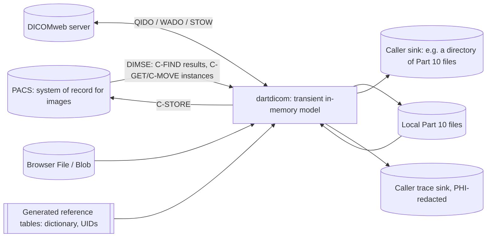
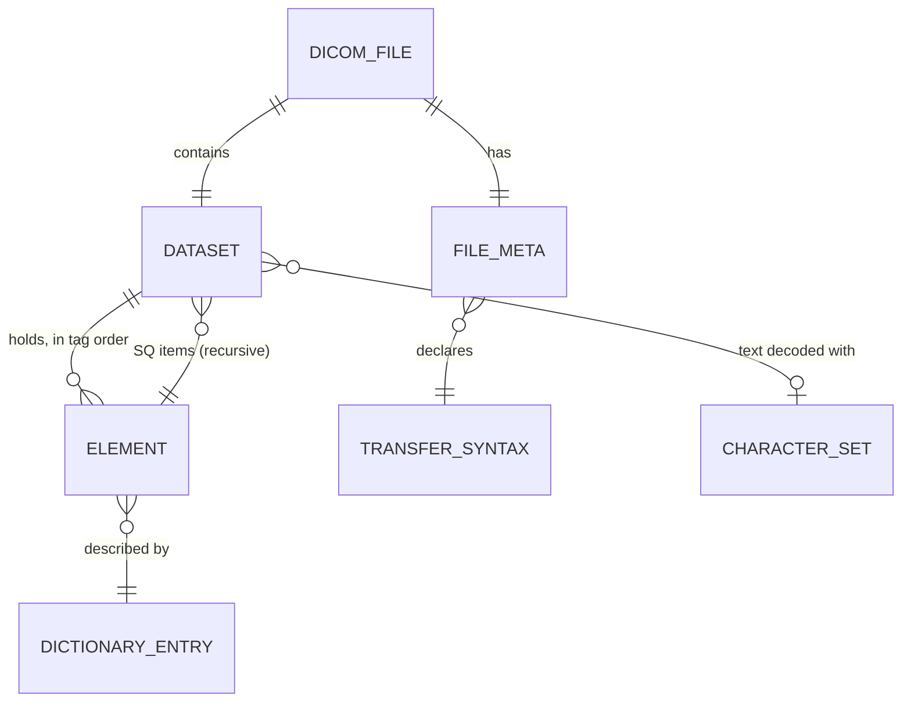
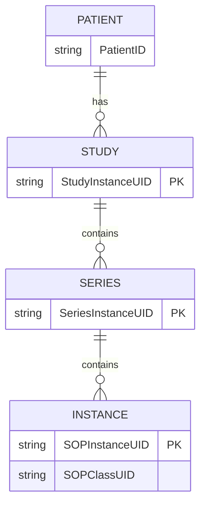
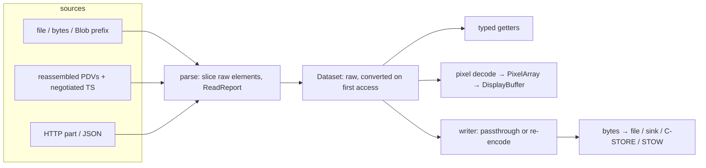
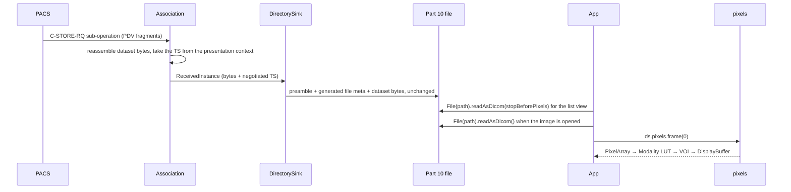
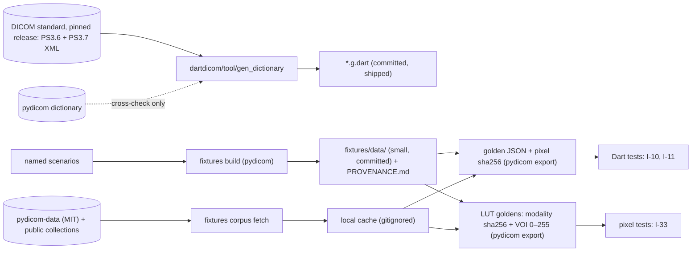

# dartdicom: data architecture

> Source: [requirements](../req/dartdicom-prd.md) and decisions D1–D4 (2026-10-16) · Date: 2026-10-16 · Mode: Design · Data system: Hybrid (file/blob encodings + message streaming + build-time provenance)
> See also: [System & OOP architecture](01-system-architecture.md) · [Developer and agent surface](03-surface-architecture.md) · [Codebase blueprint](../structure/01-codebase-blueprint.md)

Status: first-pass draft, to be refined. DA1 and DA2 were decided on 2026-10-16 (§8).

## 1. Overview

dartdicom **owns no store**. It moves DICOM information between four representations of the same data, and its job is to do that faithfully:

1. **Part 10 bytes**: files and blobs.
2. **DIMSE messages**: PDUs and PDVs over TCP.
3. **DICOMweb payloads**: DICOM JSON and `multipart/related`.
4. **The in-memory model**: `DicomFile`, `Dataset`, elements.

Two more bodies of data exist at build time: the **reference data** (the data dictionary and UID registry, generated from the standard) and the **verification data** (fixtures and golden exports).

**Classification: Hybrid.**

- **File / blob** (layout-centric): Part 10 files and the folder layout a sink writes. Evidence: PRD C-08, C-11, N-11.
- **Streaming** (motion-centric): DIMSE message streams with fragmentation, reassembly and sub-operations. Evidence: PRD N-01 to N-13.
- **Provenance pipelines**: dictionary generation and fixture or golden lineage. Evidence: PRD C-02, success criteria, and blueprint §3.

**Technology.** No database engine. Bytes are `Uint8List` and `ByteData` views. The formats come from DICOM PS3.5 (encoding), PS3.6 and PS3.7 (dictionaries), PS3.8 (Upper Layer), PS3.10 (file format) and PS3.18 (DICOMweb).

## 2. Data landscape



| Store | Kind | Holds | Written by | Read by |
|---|---|---|---|---|
| PACS | external, DIMSE | the authoritative clinical images and their index | PACS; `sendCStore` | `sendCFind`, `sendCGet`, `sendCMove` |
| DICOMweb server | external, HTTP | as above, over HTTP | STOW-RS (P1) | QIDO-RS, WADO-RS (P1) |
| Local Part 10 files | caller's file system | single instances | `File(path).writeAsDicom`, `DirectorySink` | `File(path).readAsDicom`, `FileSource` |
| Browser `Blob` / bytes | caller memory | single instances | — | `DicomFile.fromBytes`; prefix fetch (D1) |
| Caller sink | caller-owned, `InstanceSink` | received instances | net (N-11) | the caller's app |
| Trace sink | caller-owned, `TraceSink` | protocol trace | net (N-14), redacted | the developer |
| Reference tables | `*.g.dart`, shipped inside the package | tag → VR, VM, keyword, name, retired; UID registry | `dartdicom/tool/gen_dictionary` (build time) | parser, writer, keyword lookup |

The library writes nothing anywhere else: no cache directory, no temp files, no global state (PRD constraints).

## 3. Data models

### 3.1 Conceptual: what the library models



- A `Dataset` is a flat list of elements in tag order, and sequences nest datasets to any depth.
- There are **no** Patient, Study or Series entities in the library. Those exist only as attribute values inside each instance.

### 3.2 Conceptual: what the library references but doesn't own



The PACS owns this hierarchy. The library meets it in only two places:

- as the **query levels** of C-FIND, C-GET and C-MOVE (`QueryRetrieveLevel`), and in the DICOMweb URL paths
- as **UID attributes** inside each received instance, which a sink may use to lay out folders (§6)

### 3.3 Logical: key records

| Record | Attributes | Notes |
|---|---|---|
| Element (raw) | tag (u32), VR (nullable for implicit VR), length (u32; `0xFFFFFFFF` means undefined), either a value slice or {offset, length} if deferred | Never decoded until accessed (C-05) |
| Element (data) | tag, VR, decoded value (§3.4) | Cached once converted |
| File meta (group 0002) | version (0002,0001), media storage SOP class and instance (0002,0002/0003), transfer syntax (0002,0010), implementation class UID and version (0002,0012/0013), source AE (0002,0016) | Always Explicit VR LE. The writer derives it (§5) |
| `ReadReport` | a list of {kind, tag, offset}; each kind carries a fixed description *(amended)* | Records every lenient-read repair (C-10). **Holds no element values** |
| `ReceivedInstance` | SOP class UID, SOP instance UID, **negotiated transfer syntax**, dataset bytes, source AE title (the peer that sent it; (0002,0016)), file meta, presentation context ID *(amended)* | Handed to the sink (N-11, blueprint F10) |
| `RetrieveProgress` | remaining, completed, failed, warning | From command elements (0000,1020)–(0000,1023) of each C-GET or C-MOVE response (N-12) |
| `DimseStatus` | code (u16) → success, pending, warning, failure or cancel | Sealed; no default value means success (D3) |

### 3.4 The VR → Dart type contract

This mapping is the library's real "schema". It is **public API**: changing a row is a breaking change. It is also the **input to the tag generator** (DA1): every generated constant carries the Dart type from this table.

| VR family | VRs | Dart value | Notes |
|---|---|---|---|
| Text | AE, AS, CS, DA, DT, LO, LT, SH, ST, TM, UC, UI, UR, UT | `String` | Padding (space; NUL for UI) is stripped on read and added on write. DA, TM and DT are text in P0; whether they get date types (C-15) must be decided before 1.0 (§8). |
| Person name | PN | `String` in P0; possibly `PersonName` (C-15) before 1.0 | Decoded with the dataset's Specific Character Set |
| Decimal / integer strings | DS, IS | `double` (DS) / `int` (IS) | Parsed on access. The original text is kept internally, so an untouched round-trip is exact (C-15) |
| Binary integer | US, SS, UL, SL | `int` | Exact on every platform: all fit within 2⁵³ |
| 64-bit integer | SV, UV | `BigInt` | UV overflows a signed 64-bit `int`; dart2js is exact only to 2⁵³ (design §5.1) |
| Float | FL, FD | `double` | |
| Other binary | OB, OD, OF, OL, OV, OW, UN | `Uint8List` (typed views on request) | Byte order follows the transfer syntax (§4.3). Always a single value. |
| Attribute tag | AT | `Tag` | |
| Sequence | SQ | `Sequence` (a list of `Dataset`) | Items inherit the parent's charset unless they declare their own |

**Encoding text on write (decided 2026-10-16).** Text is encoded with the dataset's declared Specific Character Set, (0008,0005). The write fails with a `DicomWriteException` in two cases:

- a value the declared charset can't encode
- non-ASCII text when no charset is declared

The message names the tag and says how to fix it: *set `DicomTags.specificCharacterSet` to `'ISO_IR 192'`*. The writer never adds or changes (0008,0005) on its own; reading is lenient, writing is strict. *(amended: [blueprint F35](../structure/01-codebase-blueprint.md#1-reconciliation-findings))*

**Multiplicity: typed tags (DA1, decided 2026-10-16).** The generator turns each dictionary entry's VM into the constant's *type*:

| Dictionary VM | Generated constant | Read | Returns |
|---|---|---|---|
| `1` | `One<T>`, e.g. `DicomTags.patientName` is `One<String>` | `ds.get(tag)` / `ds.require(tag)` | `T?` / `T` (throws a missing-element error naming the tag, C-06) |
| anything else (`1-n`, `2`, `2-n`, `3`, …) | `Many<T>`, e.g. `DicomTags.windowCenter` is `Many<double>` | `ds.getAll(tag)` | `List<T>` (empty if absent) |
| no dictionary type (private tags, keyword-string lookups) | plain `Tag` | list-only getters per family (`getStrings`, `getInts`, …) | `List<…>`: nothing is truncated, nothing throws |

- **The guard is the compiler.** A singular read of a `Many` tag, a list read of a `One` tag, or a write through the wrong one is a compile error. `One` and `Many` are `extension type`s over `int`, so they cost nothing at runtime (spike, 2026-10-16).
- **The wrong value type isn't always a compile error.** When the tag and the value disagree, Dart widens `T` to `Object`, so `ds.set(DicomTags.rows, 'x')` compiles. `set` and `setAll` therefore check the value against the VR's Dart type and throw an `ArgumentError` naming the tag and the type, never the value. Closing the gap at compile time is an open question for before 1.0 (I-24). *(amended)*
- **Data that contradicts the dictionary** (a VM `1` element holding 2 values, written by a non-conformant tool) is a data error, not a caller error. `get` returns the first value *and* records a C-10 repair in the `ReadReport`.
- **VR alternatives with different Dart types** (e.g. LUT Data, `US or OW`) generate a plain `Tag`. They are read with the family getters after checking the element's VR. Alternatives with the same Dart type (`US or SS` → `int`, `OB or OW` → `Uint8List`) are typed normally.
- **Repeating groups** (`50xx`, `60xx`) are generated as functions that take the group and return a typed tag, e.g. `DicomTags.overlayData(0x6002)`.
- Rejected: (A) returning the first value with an `index:` argument, which truncates silently; and (B) throwing at runtime, which fails late on some scanners' data.

### 3.5 Physical: the encodings

**Part 10 file** (PS3.10):

```text
| 128-byte preamble | "DICM" | group 0002, Explicit VR LE, starting with a group length | dataset, in the transfer syntax from (0002,0010) |
```

**One element on the wire** (PS3.5 §7.1):

```text
Implicit VR LE  | tag 4 | length 4 | value
Explicit, short | tag 4 | VR 2 | length 2 | value                 most VRs
Explicit, long  | tag 4 | VR 2 | 0000 | length 4 | value          OB OD OF OL OV OW SQ UC UN UR UT SV UV
length FFFFFFFF = undefined; the value ends at a delimiter: Item (FFFE,E000) · Item Delim. (FFFE,E00D) · Seq. Delim. (FFFE,E0DD)
```

**Encapsulated Pixel Data.** (7FE0,0010) with undefined length, then a Basic Offset Table item, then one or more fragment items per frame, then the Sequence Delimiter. An Extended Offset Table may appear in (7FE0,0001) and (7FE0,0002).

**DIMSE** (PS3.8 / PS3.7):

```text
PDU          | type 1 | reserved 1 | length 4 (big-endian) | body
P-DATA-TF    | one or more PDVs: | length 4 | presentation context ID 1 | control header 1 (command?/last?) | fragment |
Command set  | always Implicit VR LE, group 0000, no matter which transfer syntax was negotiated
Dataset      | the presentation context's negotiated transfer syntax; the bytes themselves don't record which
```

**DICOMweb** (PS3.18), P1:

- **DICOM JSON:** `{"0010 0010" as 8 hex digits: {"vr": "PN", "Value": [...] | "InlineBinary" | "BulkDataURI"}}`.
- **Retrieve:** `multipart/related; type="application/dicom"`, with one Part 10 instance per part.

## 4. Dataflow and lineage

### 4.1 Data-flow view



### 4.2 Lineage of the first consumer: from PACS to pixels on screen



- **Store as received.** The sink writes the received dataset bytes **unchanged**; only the file meta is generated. A retrieved instance is never decoded and re-encoded on its way to disk, so a store is bit-exact. `DirectorySink` parses only the header (`stopBeforePixels`), because its path needs the Study and Series UIDs and a C-STORE-RQ command carries only the SOP UIDs. *(amended: [blueprint F39](../structure/01-codebase-blueprint.md#1-reconciliation-findings); this said storing costs no parsing)*
- **Purge.** The library deletes nothing. What the sink wrote is the caller's to keep or remove.

### 4.3 The write path

- **Same transfer syntax.** Untouched raw elements are copied byte for byte (I-10); changed elements are re-encoded.
- **Changed transfer syntax** (e.g. Implicit → Explicit VR LE).
  - Every element is re-encoded.
  - Implicit-VR elements take their VR from the dictionary, and ambiguous VRs are resolved first (C-10). An element that is still `UN` is written as `UN`.
- **Changed byte order** (reading the retired Explicit VR Big Endian, then writing Little Endian).
  - Word-based "other" VRs (OW, OF, OL, OD, OV) are **byte-swapped** by the writer.
  - pydicom doesn't do this, and it is a known pitfall. Numeric VRs need nothing extra, because they are decoded and re-encoded.
- **File meta** is regenerated on every write (§5).

### 4.4 Build-time lineage



- **The dictionary is reproducible.** Regenerating it from the pinned release must reproduce the committed files exactly (I-8). pydicom's dictionary is only a cross-check, never a source.
- **pydicom is the oracle for golden data.** When Dart and pydicom disagree, a bug is investigated on both sides. Agreement is not assumed.

## 5. Source of truth and ownership

| Fact | Source of truth | Derived copies | Rule |
|---|---|---|---|
| Clinical images and their index | PACS | received instances, sink files, C-FIND result datasets | Snapshots; the library never syncs back |
| SOP Class UID and SOP Instance UID | the dataset, (0008,0016) and (0008,0018) | file meta (0002,0002) and (0002,0003) | ⚠ **Two copies.** The writer derives the meta values from the dataset; if both are present and differ, the write fails (C-07) |
| Transfer syntax | the encoding the writer actually uses; for received data, the negotiated presentation context | file meta (0002,0010) | ⚠ **Two copies.** The meta value is always derived, never trusted on write. On read, a meta value that contradicts the data is a C-10 repair |
| How text is decoded | Specific Character Set (0008,0005), inherited by sequence items | a caller's charset override (C-13) | An override is the caller's explicit claim, and it is recorded in the `ReadReport` |
| Deferred values | the source bytes at read time | the in-memory dataset | ⚠ **Two copies over time.** On a deferred load, the `SourceOpener` checks the source's size and modification time against what it recorded at open, and **throws** `SourceChangedException` if they changed (DA2). pydicom only warns. |
| Dictionary | the DICOM standard (pinned release) | generated `*.g.dart` | Regenerated, never edited by hand (I-8) |
| Private dictionary entries | the caller, per read | — | Never global (F11) |
| PixelArray, DisplayBuffer | Pixel Data plus the pixel module attributes; each frame's Modality LUT and VOI from its functional groups, else the top level (blueprint F44) | — | Derived and never written back |
| Golden expectations | pydicom (the oracle), run over the fixtures | committed golden JSON | Regenerated by `fixtures golden` |

## 6. Storage and access

- **Tag order is a data invariant.** Writing requires ascending tags, so the dataset keeps its elements sorted. Lookup is by tag; keyword lookup goes through the dictionary.
- **Views pin their buffer.**
  - A raw element parsed from a `BytesSource` is a zero-copy view, so it keeps the *whole* input buffer alive while any raw element remains.
  - A `FileSource` reads values into their own small buffers, so a header-only read of a large file pins nothing. This is what makes C-09 and C-20 hold on native.
- **Deferral.** A value larger than `deferSize` is stored as {offset, length} plus a `SourceOpener`. A deferred `Dataset` can be sent to a worker isolate, because the opener reopens by path (design §7).
- **Pixel views.**
  - Native Pixel Data becomes a typed view (`Int16List`, …) only when the byte offset is aligned to the element size and the data's byte order matches the host's; otherwise it is copied.
  - Values start on even offsets, so 16-bit views are usually zero-copy. 32-bit views need a 4-byte-aligned offset, so they may be copied.
  - 1-bit data is unpacked, and PlanarConfiguration 1 is interleaved, so both are always copied. Unused high bits that hold garbage are masked, which copies too.
  - A view aliases the dataset's bytes (and so the whole input buffer, F19), so `values` is unmodifiable: an in-place edit would otherwise reach the writer as "untouched" bytes *(amended: surface S12)*.
- **Frames.** Random access to an encapsulated frame uses the Basic or Extended Offset Table. Without either, the fragments are scanned once.
- **Network memory.** One message is reassembled at a time. Peak memory is about one instance (N-11); streaming a single huge instance to disk is N-17 (P2).
- **DICOMweb.** Multipart responses are parsed as a stream, and each part is handed over on its own (W-04).
- **`DirectorySink` layout.** The default is `<root>/<StudyInstanceUID>/<SeriesInstanceUID>/<SOPInstanceUID>.dcm`.
  - UIDs contain only digits and dots, so they are safe in file names.
  - No other attribute (and so no patient name) ever appears in a path.
  - The layout is a constructor parameter.

## 7. Lifecycle and governance

- **Schema evolution.**
  - The data model follows the DICOM standard, which grows with every release (the 64-bit VRs OV, SV and UV are recent additions). The dictionary is pinned to one release; moving to a new release is a minor version of `dartdicom`. Retired elements stay, flagged as retired.
  - Tags unknown to the pinned release still read: explicit VR keeps its VR, and implicit VR becomes `UN`.
  - The VR → Dart contract (§3.4) changes only with a major version.
- **Retention.** The library keeps nothing: no disk cache, no temp files. P0 needs no temporary storage at all. When N-17 arrives, it writes only into a directory the caller chooses; pynetdicom's habit of using the OS temp directory is the lesson here.
- **PHI.**
  - Every element value is treated as potentially PHI.
  - Values never appear in logs, exception messages or the default `toString`, and the protocol trace is redacted (I-9).
  - A dump masks values unless the caller opts in (C-21).
  - The `ReadReport` holds tags and offsets, not values.
  - Sink paths use UIDs only.
  - De-identification (C-22, P2) is an explicit call the caller makes, never a side effect.
- **Test data.**
  - The repository holds only synthetic fixtures and MIT-licensed public files, each with a `PROVENANCE.md` entry.
  - Fetched collections keep their own licenses (some are CC BY-NC), live in a gitignored cache, and are never committed.
  - Clinical data is never used in tests.
- **Integrity.** Store as received (§4.2), byte-identical round-trips (I-10), element-level agreement with pydicom (I-11).

## 8. Decisions needed and assumptions

| # | Decision | Proposal | Where |
|---|---|---|---|
| DA1 | Singular reads of multi-valued elements | **Decided 2026-10-16:** typed tags (`One<T>` / `Many<T>`), so a wrong read is a compile error. Rejected: first value + `index:`; throwing at runtime. | §3.4 |
| DA2 | Deferred load after the source has changed | **Decided 2026-10-16:** throw `SourceChangedException`. Rejected: load anyway and warn (pydicom); no check. | §5 |

**Settled here** (each follows from earlier decisions or PRD constraints):

- store as received
- the writer byte-swaps OW-family values when the byte order changes
- file meta is always derived from the dataset
- `FileSource` copies values, while `BytesSource` uses views
- the `DirectorySink` layout keyed by UIDs (configurable)
- the VR → Dart contract in §3.4

**Open, not blocking P0:**

- where the fetched-corpus cache lives (a gitignored folder in the repo, or the user's cache directory)
- **Before 1.0:** whether PN becomes `PersonName` and DA/TM/DT become date types (C-15). Typed tags fix each VR's Dart type in every generated constant, so these are no longer additive changes; they are free only before 1.0.

**External assumptions:**

- A PACS decompresses when it is offered only uncompressed transfer syntaxes.
- Specific Character Set labels in the wild are sometimes wrong (C-13).
- The target PACS products support C-GET (PRD open question).
