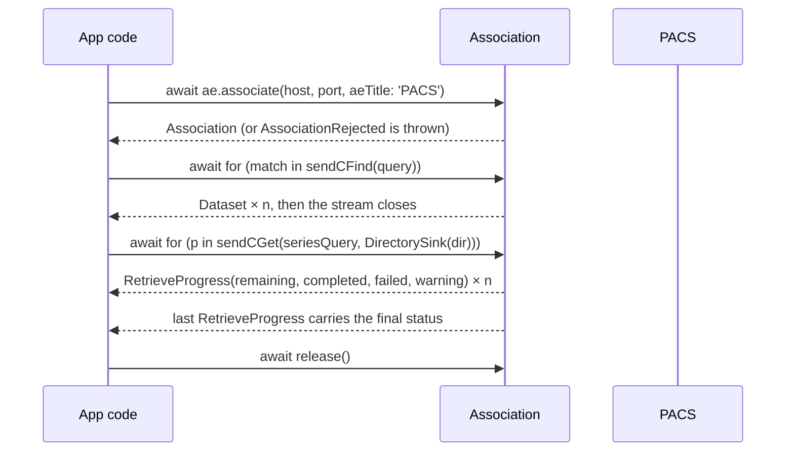
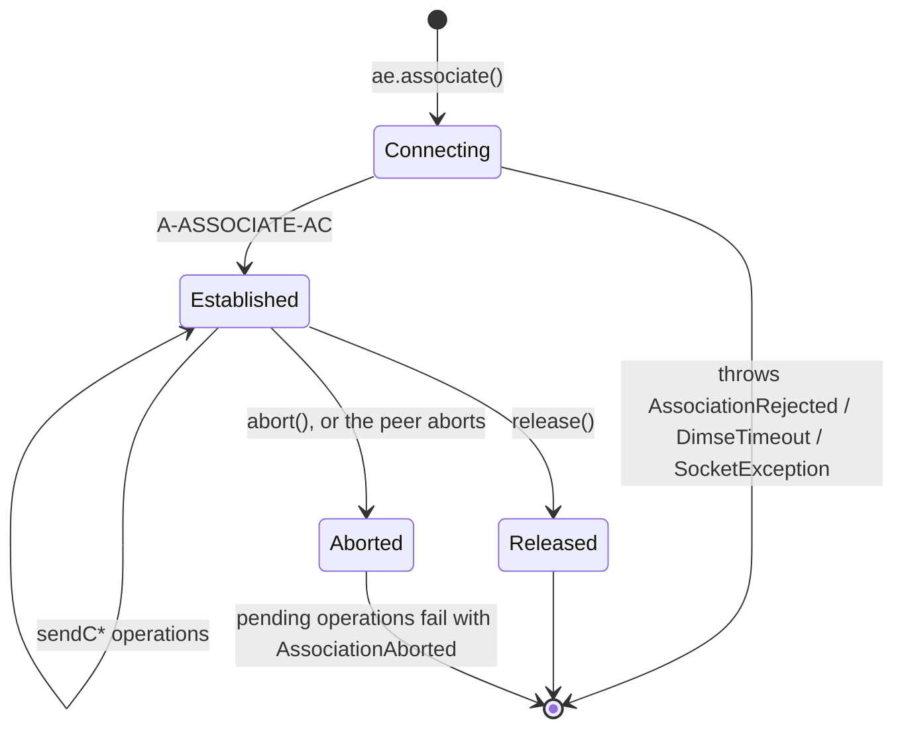

# dartdicom: developer and agent surface (DX / AX)

> Source: [requirements](../req/dartdicom-prd.md), design decisions D1–D4 and data decisions DA1–DA2 (2026-10-16) · Date: 2026-10-16 · Mode: Design · Surface: Library / SDK (four pub packages; no CLI)
> See also: [System & OOP architecture](01-system-architecture.md) · [Data architecture](02-data-architecture.md) · [Codebase blueprint](../structure/01-codebase-blueprint.md)

Status: first-pass draft, to be refined. Names come from the design inputs. Names first proposed in this doc are listed in §8. Decisions S1–S5 were made on 2026-10-16 (§8).

## Cheat Sheet

```dart
import 'package:dartdicom/dartdicom.dart';          // core, any platform
import 'package:dartdicom/io.dart';                 // native: File extensions
import 'package:dartdicom_pixel/dartdicom_pixel.dart';
import 'package:dartdicom_net/dartdicom_net.dart';

// Read
final file = await File('ct.dcm').readAsDicom();                // async; readAsDicomSync() also exists
final head = DicomFile.fromBytes(bytes,
    options: const ReadOptions(stopBeforePixels: true));        // any platform
final ds = file.dataset;

// Typed reads: the tag decides the type and the multiplicity
final String? name = ds.get(DicomTags.patientName);
final String uid  = ds.require(DicomTags.sopInstanceUid);            // throws if absent
final List<double> wc = ds.getAll(DicomTags.windowCenter);

// Modify and write
ds.set(DicomTags.patientName, 'Anonymous');
await File('anon.dcm').writeAsDicom(file);

// Pixels → screen
final img = ds.pixels.frame(0).toDisplay(ds.voiWindow());       // DisplayBuffer (8-bit)

// PACS
final ae = ApplicationEntity(aeTitle: 'MYAPP',
    requestedContexts: PresentationContexts.studyRootQueryRetrieve);   // S2
final assoc = await ae.associate('pacs.local', 104, aeTitle: 'PACS');
await for (final match in assoc.sendCFind(query)) { /* ... */ }
await for (final p in assoc.sendCGet(seriesQuery, DirectorySink(dir))) { /* progress */ }
await assoc.release();
```

## 1. Overview

dartdicom lets Dart and Flutter code read, modify, write, display and exchange DICOM data, with no native toolchain.

**Surface type: Library / SDK.** Four pub packages and their public libraries:

| Import | Holds |
|---|---|
| `package:dartdicom/dartdicom.dart` | the core; pure Dart, every platform |
| `package:dartdicom/io.dart` | native file access |
| `package:dartdicom_pixel/dartdicom_pixel.dart` | pixel decoding and display |
| `package:dartdicom_net/dartdicom_net.dart` | DIMSE networking |
| `package:dartdicom_web/dartdicom_web.dart` | DICOMweb client |

Evidence: PRD §Capabilities; design §3. There is no CLI, so this doc has no CLI section.

**Users** reach the surface by adding the packages to `pubspec.yaml` and importing them:

| User | What they need from the surface |
|---|---|
| **Flutter desktop developer** (the first consumer) | query and retrieve, then display |
| **Dart backend / CLI developer** | receive, route, anonymize |
| **Web developer** | DICOMweb |
| **AI coding agent** writing code against the API for any of the above | treated as a first-class reader of the API, its docs and its errors (§6.4) |

## 2. Surface map

```mermaid
flowchart TD
    core["dartdicom"] --> df["DicomFile: fromBytes · toBytes · meta · dataset"]
    core --> dsn["Dataset: get · require · getAll · set · remove · dump"]
    core --> tg["DicomTags · TransferSyntaxes · SopClasses (generated)"]
    core --> ro["ReadOptions · WriteOptions · ReadReport"]
    io["dartdicom/io.dart"] --> fx["File.readAsDicom / Sync · writeAsDicom / Sync"]
    px["dartdicom_pixel"] --> pv["ds.pixels.frame(i) · PixelArray · toDisplay · DisplayBuffer"]
    net["dartdicom_net"] --> ae["ApplicationEntity · associate"]
    net --> as["Association: sendCEcho / CFind / CGet / CMove / CStore · release · abort"]
    net --> scp["StorageScp · InstanceSink · DirectorySink"]
    web["dartdicom_web"] --> wc["DicomWebClient: searchForStudies · retrieveInstance · storeInstances"]
```



| Touchpoint | What the user does with it | Req. |
|---|---|---|
| `DicomFile.fromBytes(bytes, {options})` | parse bytes from anywhere (memory, Blob, HTTP, PDVs) | C-08 |
| `file.toBytes({options})` | encode to Part 10 bytes | C-11 |
| `Dataset.fromBytes(bytes, transferSyntax:)` / `ds.toBytes(transferSyntax:)` | a bare dataset with no Part 10 header, e.g. a DIMSE identifier (S7) | C-08, N-04 |
| `ds.transferSyntax` | the encoding a dataset was read in; `null` if it was built in memory (blueprint F4) | X-03 |
| `FileMetaInformation.forInstance(...)` · `meta.toHeaderBytes()` | the preamble, `DICM` and group 0002 that precede a dataset in a Part 10 file; lets a sink store bytes as received | C-07, N-11 |
| `File(p).readAsDicom({options})` / `readAsDicomSync` | read from disk; async by default | C-20 |
| `File(p).writeAsDicom(file)` / `writeAsDicomSync` | write to disk | C-20 |
| `file.meta` / `file.dataset` | file meta (group 0002) vs content | C-07 |
| `ds.get(One<T>)` → `T?` | optional single-value read | C-06, DA1 |
| `ds.require(One<T>)` → `T` | required single-value read; throws if absent | C-06, DA1 |
| `ds.getAll(Many<T>)` → `List<T>` | multi-value read; empty if absent | DA1 |
| `ds.getStrings(Tag)` and the other family list getters | reads for untyped tags (private tags, keyword lookups) | DA1 |
| `ds.set(One<T>, T)` / `ds.setAll(Many<T>, List<T>)` / `ds.setEmpty(tag)` / `ds.remove(tag)` | modify (S1) | C-06 |
| `DicomTags.*` · `TransferSyntaxes.*` · `SopClasses.*` | generated constants | C-03, C-16 |
| `ReadOptions` · `WriteOptions` | per-call options | C-09, C-11 |
| `file.report` / `ds.report` (`ReadReport`) | the repairs lenient reading made (C-10); `ds.report` for `Dataset.fromBytes` *(amended)* | C-10 |
| `ds.dump()` | readable tree; values masked unless opted in | C-21 |
| `ds.pixels.frame(i)` → `PixelArray` | decode one frame | X-01–X-03 |
| `.toDisplay(window)` → `DisplayBuffer` · `ds.voiWindow()` | apply LUTs, get 8-bit pixels: `gray`, or `toRgba()` (S8) | X-04, X-07 |
| `ApplicationEntity(...)` · `.associate(host, port, aeTitle:)` | configure and connect (S2) | N-05 |
| `assoc.sendCEcho()` · `sendCStore(file)` | single-response operations → `DimseStatus` | N-06, N-10 |
| `assoc.sendCFind(query)` | stream of matches (S5) | N-07 |
| `assoc.sendCGet(query, sink)` · `sendCMove(query, destAe)` | retrieve with `RetrieveProgress` events | N-08, N-09, N-12 |
| `assoc.release()` · `abort()` | end the association | N-13 |
| `StorageScp(...).start()` · `close()` | receive C-MOVE deliveries | N-09 |
| `DirectorySink(dir)` · `InstanceSink` | where received instances go | N-11 |
| `DicomWebClient(baseUri, {client, auth})` and its `searchFor*` / `retrieve*` / `storeInstances` | DICOMweb (P1) | W-01–W-06 |

## 3. Entry and onboarding

**Install.** For the first consumer:

```yaml
dependencies:
  dartdicom: ^0.1.0
  dartdicom_pixel: ^0.1.0
  dartdicom_net: ^0.1.0   # native platforms only
```

The package floor is Dart 3.6 (`sdk: ^3.6.0`). No native toolchain, FFI or Rust is needed.

**Hello world**, the first thing the README shows:

```dart
import 'dart:io';
import 'package:dartdicom/dartdicom.dart';
import 'package:dartdicom/io.dart';

Future<void> main() async {
  final file = await File('ct.dcm').readAsDicom();
  print(file.dataset.get(DicomTags.modality));     // CT
  print(file.dataset);                        // Dataset(84 elements): no values, PHI-safe
  print(file.dataset.dump(showValues: true)); // explicit opt-in to see values
}
```

**The pydicom → dartdicom mapping** is a required README section, and the same table goes into `llms.txt` (§6.4). It is how pydicom users and agents with a pydicom prior get here:

| pydicom / pynetdicom | dartdicom |
|---|---|
| `dcmread(path)` | `await File(path).readAsDicom()` (or `readAsDicomSync()`) |
| `dcmread(BytesIO(b))` | `DicomFile.fromBytes(b)` |
| `dcmread(path, stop_before_pixels=True)` | `readAsDicom(options: const ReadOptions(stopBeforePixels: true))` |
| `ds.PatientName` / `ds[0x00100010].value` | `ds.get(DicomTags.patientName)` |
| `ds.WindowCenter` (MultiValue) | `ds.getAll(DicomTags.windowCenter)` |
| `ds.PatientName = 'X'` | `ds.set(DicomTags.patientName, 'X')` |
| `del ds.PatientName` | `ds.remove(DicomTags.patientName)` |
| `ds.save_as(path)` / `dcmwrite(path, ds)` | `await File(path).writeAsDicom(file)` |
| `ds.pixel_array` | `ds.pixels.frame(i)` (one frame; decoding is a method) |
| `AE(ae_title=...)`, `ae.add_requested_context(...)` | `ApplicationEntity(aeTitle: ..., requestedContexts: [...])` (S2) |
| `assoc.send_c_find(ds, model)` (generator) | `assoc.sendCFind(query)` (a `Stream`) |
| `evt.EVT_C_STORE` handler | an `InstanceSink` (`DirectorySink`, or your own) |
| `DICOMwebClient(url).search_for_studies()` | `DicomWebClient(uri).searchForStudies()` |

## 4. Key journeys

### 4.1 Open a file and display a frame (Flutter desktop)

```dart
// List view: header only. Pixel Data is never loaded.
final head = await File(path).readAsDicom(
    options: const ReadOptions(stopBeforePixels: true));
final desc = head.dataset.get(DicomTags.seriesDescription);

// Viewer: full read, then one frame to the screen.
final file = await File(path).readAsDicom();
final ds = file.dataset;
final buf = ds.pixels.frame(0).toDisplay(ds.voiWindow());  // DisplayBuffer: width, height, gray
// Flutter side (the app's code): ui.decodeImageFromPixels(buf.toRgba(), buf.width, buf.height, ...)
```

The library stops at an 8-bit RGBA buffer. Turning it into a widget is the app's job, because no package depends on Flutter.

### 4.2 Query and retrieve from a PACS



```dart
final query = Dataset()
  ..set(DicomTags.queryRetrieveLevel, 'STUDY')
  ..set(DicomTags.patientId, 'P001')
  ..setEmpty(DicomTags.studyInstanceUid)     // an empty element means "return this key" (S3)
  ..setEmpty(DicomTags.studyDescription);

await for (final match in assoc.sendCFind(query)) {
  print(match.get(DicomTags.studyDescription));
}

final sub = assoc.sendCGet(seriesQuery, DirectorySink(dir)).listen(
  (p) => progressBar.value = p.completed / p.total,
);
// The user presses Stop:
await sub.cancel();                       // sends C-CANCEL-RQ (F14)
```

### 4.3 Modify and write (e.g. a minimal anonymization)

```dart
final file = File(path).readAsDicomSync();
if (!file.report.isClean) log(file.report.summary());   // repairs made; never values
file.dataset
  ..set(DicomTags.patientName, 'Anonymous')
  ..remove(DicomTags.patientBirthDate);
File(outPath).writeAsDicomSync(file);   // untouched elements are copied byte for byte
```

## 5. Interaction and state: the error and return contract

**Read results.**

| Situation | What the caller gets |
|---|---|
| Optional element absent | `get` → `null`; `getAll` → `[]` |
| Required element absent | `require` throws `MissingElementException`, naming the tag and keyword, never a value |
| Real-world data needed repair (C-10) | The read succeeds; `file.report` lists every repair |
| A VM-1 element holds several values (bad data) | `get` returns the first value, plus a `ReadReport` entry (DA1) |
| Unreadable or truncated beyond repair | `DicomParseException`, with the offset and the tag where it stopped |
| A deferred value's file changed on disk | `SourceChangedException` (DA2) |
| Invalid write (meta and dataset UIDs conflict, value too long, text the declared charset can't encode, non-ASCII text with no Specific Character Set, …) | `DicomWriteException` with the fix in its message (e.g. *set `DicomTags.specificCharacterSet` to `'ISO_IR 192'`*); nothing is written (C-07, C-11, data §3.4) |

**Association lifecycle** (user-visible):



**Operation outcomes** (D3): failures of transport, association or protocol **throw**. DIMSE outcomes are **values**.

| Operation | Returns | Final failure status |
|---|---|---|
| `sendCEcho()`, `sendCStore(file)` | `Future<DimseStatus>` (sealed: `DimseSuccess`, `DimsePending`, `DimseWarning`, `DimseFailure`, `DimseCancel`; *amended in M1: prefixed, because bare `Success` / `Failure` collide with common result-type packages*) | a value; `.orThrow()` opts into an exception |
| `sendCGet` / `sendCMove` | `Stream<RetrieveProgress>`; the last event carries the final `DimseStatus` | S5 |
| `sendCFind` | `Stream<Dataset>` of matches | S5 |

- **S5: final status on streams (decided 2026-10-16).**
  - Streams complete normally on `Success`, `Warning` and `Cancel`.
  - A final **`Failure`** becomes a stream error, `DimseFailureException(status)`, so a C-FIND that failed never looks like "no matches".
  - Retrieves still deliver the final status in their last `RetrieveProgress`, which keeps partial failures visible without throwing.

  This refines D3 for multi-response operations.

**Exceptions** all extend `DicomException`.

- Each package keeps its own **sealed** subtree, which callers can `switch` on exhaustively: `DicomDataException` in core (parse, write, missing element, source changed), `DimseException` in net (rejected, aborted, timeout, protocol violation, `DimseFailureException`), and `DicomWebException` in web.
- One sealed tree across all packages isn't possible: Dart only allows a sealed class's subtypes in its own library *(amended: [blueprint F30](../structure/01-codebase-blueprint.md#1-reconciliation-findings))*.
- Subtype names are listed in §8. Every message names the tag (number *and* keyword) or the offset, and says what to do next. It never contains a value (I-9).

## 6. API ergonomics

### 6.1 The naming rule (D4)

**Use Dart's convention where Dart has one, and the DICOM vocabulary where it doesn't.** See design §6 for the full table. The short version:

- **Shaped by Dart:** `fromBytes` / `toBytes`; `readAsDicom` / `readAsDicomSync`, mirroring `dart:io`; cheap getters but methods for costly work (`ds.pixels.frame(i)`); constants grouped like `Colors.red` (`DicomTags.patientName`).
- **Named by DICOM:**
  - concepts: `Dataset`, `DataElement`, `Tag`, `Sequence`, `FileMetaInformation`, `TransferSyntaxes`, `SopClasses`
  - DIMSE: `sendCFind`, which is also a verb phrase for a side effect
  - DICOMweb: `searchForStudies`, the PS3.18 transaction names

### 6.2 Keyword → identifier

- **S4: the identifier rule (decided 2026-10-16).** Generated constants follow Effective Dart: lowerCamelCase, with acronyms folded like words.
  - Examples: `SOPInstanceUID` → `sopInstanceUid`, `PatientID` → `patientId`, `RTDoseROISequence` → `rtDoseRoiSequence`.
  - Every constant's dartdoc starts with the DICOM keyword, the tag, VR and VM (`/// SOPInstanceUID (0008,0018) · UI · 1`), so searching for the standard's spelling still finds it.
  - The generator fails on any collision.
  - This rule fixes about 5,000 public names, so it is the hardest naming choice to undo after publishing.

- **VR codes keep DICOM's uppercase** (decided 2026-10-17) (`Vr.PN`, `Vr.IS`), an exception to lowerCamelCase decided during M0. Lowercase `is` is a reserved word, and the two-letter codes are the vocabulary every DICOM reader already uses (pydicom's `VR.IS`, fo-dicom's `DicomVR.IS`).

### 6.3 Consistency rules

| Rule | Applies to |
|---|---|
| The tag's type decides the read: `One<T>` → `get` / `require`, `Many<T>` → `getAll`; a misuse doesn't compile (DA1) | every element read |
| Nullable means optional, `require` means mandatory; lists are never `null` | every read |
| Core is synchronous over bytes (D1). File I/O is async by default, with a `Sync` twin. Network calls are always async. | every entry point |
| Results that arrive over time are a `Stream`; cancelling the subscription cancels the operation | `sendCFind`, `sendCGet`, `sendCMove` |
| Options are immutable `const`-able objects passed per call or per instance; nothing is global | every option (§7) |
| The default `toString` never prints values; dumping them is an explicit opt-in | `Dataset`, `DataElement`, `DicomFile`, exceptions |
| SV and UV are `BigInt`; DS and IS are `double` / `int`, with their text kept | data §3.4 |

### 6.4 Agent experience (AX)

The PRD and the user's design rules treat agents as a first audience of the API, docs and errors. These are the surface's commitments to them; this is not an `ax-interface` audit.

- **The compiler is the agent's fastest feedback loop.** Typed tags turn the most common DICOM mistakes into analyzer errors at the line where they happen: a wrong value type, a singular read of a multi-valued tag, a misspelled tag.
- **Bridges from what agents already know.**
  - The README's pydicom mapping table (§3) and a package-root **`llms.txt`** give the cheat sheet, the mapping and the naming rules in a few hundred lines.
  - The DICOM keyword sits in every constant's dartdoc (§6.2).
- **Errors that teach.** A message names the tag, its keyword and the next move. For example: `MissingElementException: (0008,0018) SOPInstanceUID is required but absent; use ds.get(...) for optional reads`. Exception types are sealed, so a program can branch on them.
- **Economical output.** The default `toString` is one line. `dump()` takes `maxDepth` and `showValues`. `ReadReport.summary()` is a compact list of repair kinds and tags.
- **Executable docs.** `examples/` runs end to end against the test PACS, so an agent can copy a working path instead of guessing one.

## 7. Configuration and customization

Everything is passed per call or per instance. Nothing is global (PRD constraint).

| Object | Settings | Req. |
|---|---|---|
| `ReadOptions` | `stopBeforePixels`, `deferSize`, `tags` (read only these), `force` (no preamble), `hooks` (VR and value conversion), `charset` (override or fallback), `dictionary` (private entries) | C-09, C-13, C-19, F11 |
| `WriteOptions` | `transferSyntax` (re-encode; default: keep the original), `deflateCodec` | C-11 |
| `ApplicationEntity` | `aeTitle`, `requestedContexts`, `retrieveStorageClasses` (adds storage contexts and SCP role selection for C-GET), `timeouts` (ACSE, DIMSE, network, connect), `maxPduLength`, `trace` (`TraceSink` with levels DIMSE → PDU/state machine → hex, redacted) | N-01, N-05, N-13, N-14 |
| `StorageScp` | `port`, `sink`, `acceptFrom` (the calling AE titles allowed) | N-09 |
| `DirectorySink` | `root`, and `layout` (default: `<Study>/<Series>/<SOP>.dcm`, UIDs only) | N-11, data §6 |
| `CodecRegistry` | the decoder plugins for a pixel call or decoder | X-05 |
| `DicomWebClient` | `client` (`http.Client`), `auth` (`AuthProvider`), `retry` (off by default) | W-01, W-06 |

- **S2: AE configuration shape (decided 2026-10-16).**
  - `ApplicationEntity` is an immutable value built in one constructor call, where pynetdicom adds contexts one by one with `add_requested_context`.
  - Preset context lists are provided (e.g. `PresentationContexts.verification`, `PresentationContexts.storage`).
  - `retrieveStorageClasses` hides C-GET's role-selection detail.

## 8. Decisions

| # | Decision | Outcome (2026-10-16) | Where |
|---|---|---|---|
| S1 | Writing API names | **Decided.** `set(One<T>, T)` · `setAll(Many<T>, List<T>)` · `setEmpty(tag)`, a zero-length element (a Type 2 "present but empty" attribute, or a C-FIND return key) · `remove(tag)` · for untyped tags, `setRaw(tag, vr, values)` | §2, §4.3 |
| S2 | AE configuration shape | **Decided.** An immutable constructor, preset context lists, and `retrieveStorageClasses` for C-GET | §7 |
| S3 | How a C-FIND query is built | **Decided.** A plain `Dataset`, using `setEmpty` for return keys (pynetdicom's model and the standard's own), rather than a separate typed query builder | §4.2 |
| S4 | Keyword → identifier rule | **Decided.** Effective Dart lowerCamelCase, acronyms folded (`sopInstanceUid`), the DICOM keyword in dartdoc, the generator failing on collisions | §6.2 |
| S5 | Final status of multi-response operations | **Decided.** Complete normally on Success, Warning or Cancel; a final Failure becomes a stream error; retrieves also carry the final status in their last progress event (refines D3) | §5 |
| S6 | Name of the generated tag namespace | **Decided 2026-10-17: `DicomTags`** (`DicomTags.patientName`). `Tags` collided with `package:test`'s `Tags` (found in M0), which would give every consumer test file an `ambiguous_import`. Rejected: static constants on `Tag` (the generator would have to emit the whole `Tag` type, with its hand-written members in a template), and keeping `Tags` with a documented `hide`. | §6.2 |
| S7 | How a bare dataset (no Part 10 header) is decoded and encoded | **Decided 2026-10-17:** `Dataset.fromBytes(bytes, transferSyntax:)` / `ds.toBytes(transferSyntax:)`, mirroring `DicomFile`; the required `transferSyntax:` tells the two apart. Rejected: a `DatasetCodec` value (it keeps I-5 strict, but is harder to find). Blueprint F38. | §2 |
| S9 | How code reaches private elements (C-06) | **Decided 2026-10-17:** `ds.privateBlock(group, creator, {create})` returns a `PrivateBlock` (or `null`); `block.tag(offset)` gives the full tag; values go through the untyped getters and `setRaw`. Mirrors pydicom's `private_block`. Rejected: a block with its own getters and setters. | §2 |
| S10 | What `Uid.generate()` uses as its root (C-16) | **Decided 2026-10-17:** `2.25.` + a random UUID (v4) as an integer (PS3.5 §B.2), so no registration is needed; `prefix:` takes an organization's root. Rejected: registering a project root. | §2 |
| S8 | What `DisplayBuffer` holds | **Decided 2026-10-17:** 8-bit `gray` (one byte per pixel), with `toRgba()` as a method because it allocates 4× the memory. Color (X-08) adds channels later. Rejected: an `rgba` getter. | §2, §4.1 |

**Rejected:**

- S1: an immutable dataset with copy-on-write
- S2: a pynetdicom-style mutable AE with `add*` methods
- S3: a typed query builder per level
- S4: keeping DICOM's acronyms (`sopInstanceUID`)
- S5: exposing only a `status` Future (a failure would go unnoticed if nobody checked it), and making every non-success status an error

**Names first proposed in this doc.** Each one needs a home in the blueprint before M1:

- **Reads and writes:** `setAll`, `setEmpty`, `setRaw`, `remove`, `dump`, `getStrings`
- **Read results:** `file.report`, `ReadReport.isClean` / `summary()`, `MissingElementException`, `DicomParseException`, `DicomWriteException`, `DimseFailureException`
- **Network:** `RetrieveProgress.total` / `status`, `PresentationContexts.*`, `retrieveStorageClasses`, `timeouts`, `trace`
- **Pixels:** `DisplayBuffer.gray` / `toRgba()` / `width` / `height` *(amended: S8)*
- **Added in M2 planning (2026-10-17):** `ds.privateBlock` / `PrivateBlock.tag` (S9), `Uid.generate` / `isValid` (S10), `ds.element(tag)` (the untyped escape hatch F36 otherwise closes), `DicomFile.fromSource(ByteSource)`, `ByteSource` / `BytesSource` / `SourceOpener`, `DeflateCodec`, `SourceChangedException`
- **Added in M1 planning (2026-10-17):** `Dataset.fromBytes` / `toBytes` (S7), `ds.transferSyntax`, `FileMetaInformation.forInstance` / `toHeaderBytes()`, `ReceivedInstance.sourceAeTitle` / `fileMeta`, `PresentationContexts.commonStorage`
- **DICOMweb:** `retry`

**Not covered:** the DICOMweb surface beyond its names (P1). It gets its own journey once it is scheduled.
